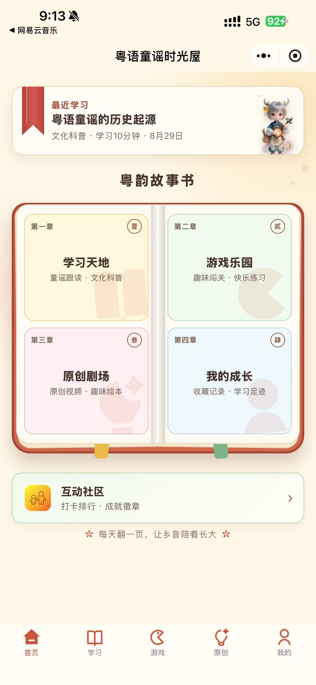
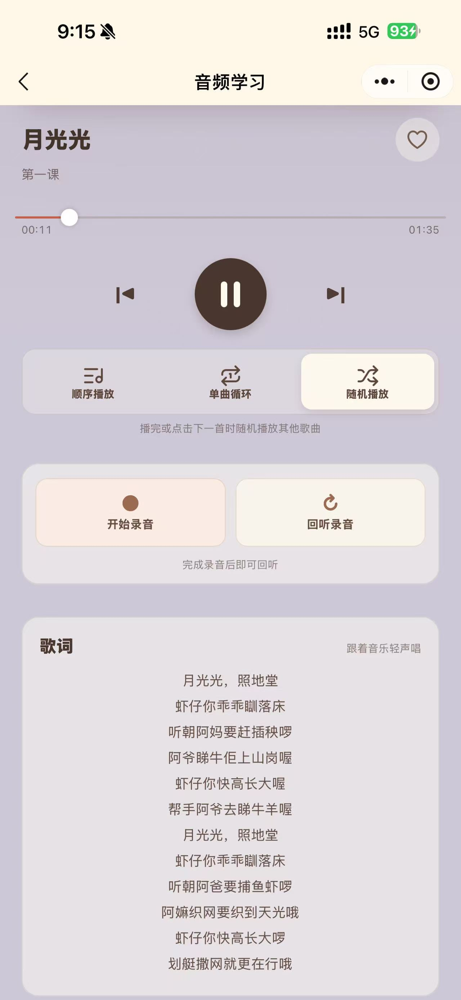
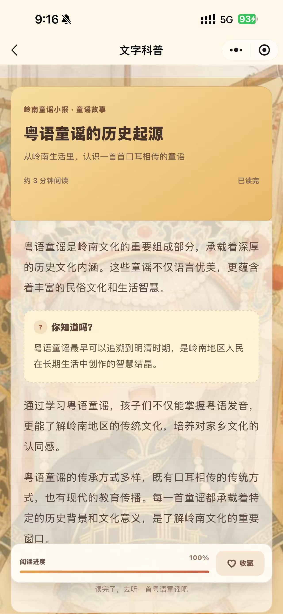
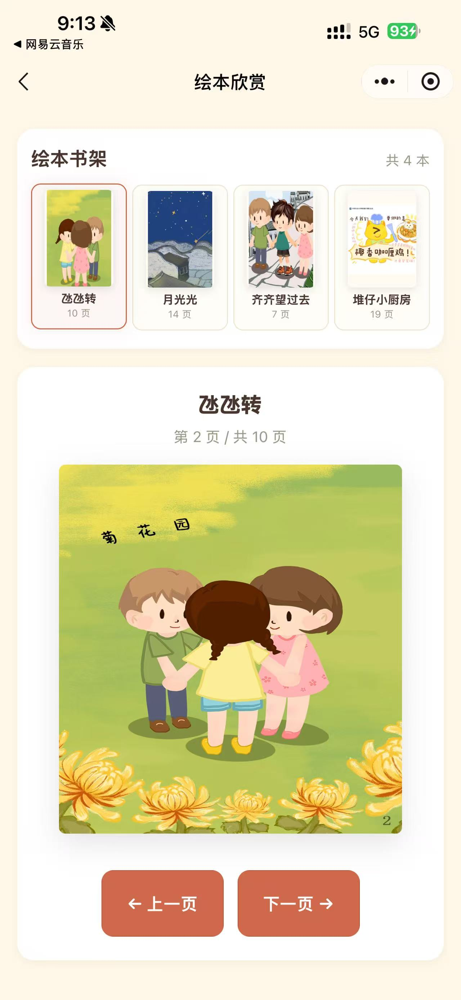
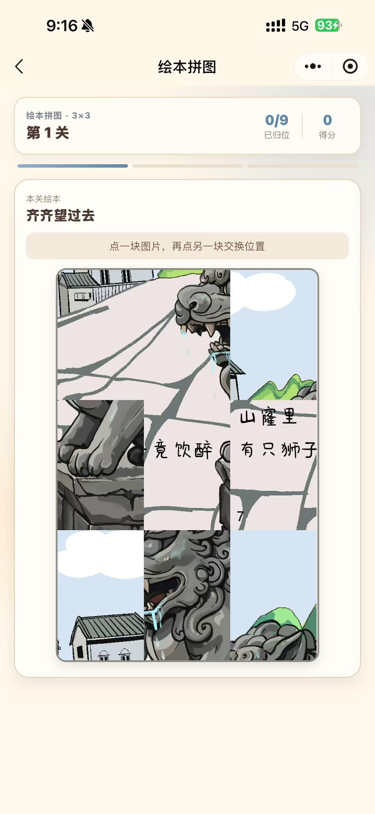
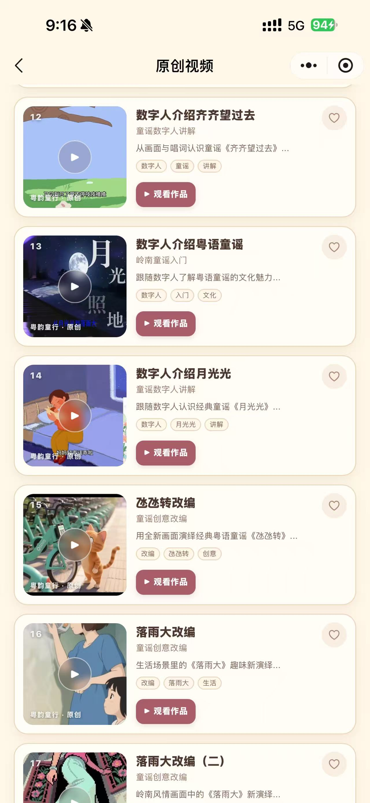
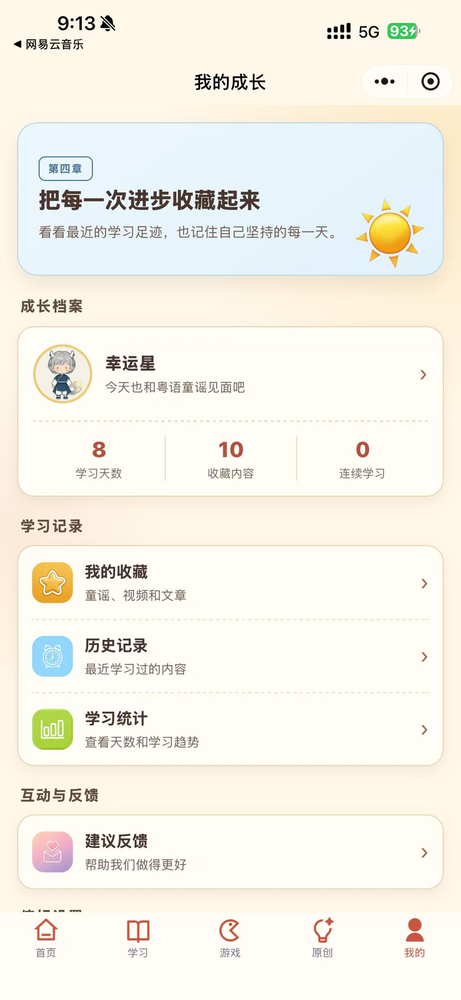

# 粤语童谣时光屋


> 和孩子一起听童谣、读故事，认识粤语里的生活与文化。

粤语童谣时光屋是一款已上线的微信小程序。在这里，可以听粤语童谣、看视频和绘本，也可以玩接龙、拼图等小游戏。我们希望把童谣里好听、好玩、有意思的东西留下来，让孩子愿意听、愿意唱，也让家长多一种陪伴孩子的方式。

打开微信，搜索 **「粤语童谣时光屋」** 就能找到我们。

## 小程序长什么样

<table>
  <tr>
    <th>首页</th>
    <th>音频学习</th>
    <th>文字科普</th>
  </tr>
  <tr>
    <td></td>
    <td></td>
    <td></td>
  </tr>
  <tr>
    <th>绘本欣赏</th>
    <th>绘本拼图</th>
    <th>原创视频</th>
  </tr>
  <tr>
    <td></td>
    <td></td>
    <td></td>
  </tr>
</table>

<details>
  <summary>我的成长：查看收藏、学习记录和统计（点击展开）</summary>
  <p></p>
</details>

## 可以做些什么

- **听童谣**：边听边看歌词，遇到喜欢的就收藏起来，下次接着听。
- **读故事**：翻翻绘本，看看科普文章，了解童谣里的故事和粤语文化。
- **玩游戏**：试试童谣接龙、消消乐、歌词排序、图片拼图，还有每日答题。
- **看原创作品**：观看原创童谣视频，也可以打开童谣课程手册，找找亲子活动和教学的灵感。
- **一起录音**：录下自己或和孩子一起唱的童谣，再回放听听。
- **记录成长**：查看学习记录和收藏，打卡，或在成长分享墙分享今天的学习。

## 数据存在哪里

粤语童谣时光屋使用腾讯云提供的**微信云开发（CloudBase）**。需要上传的数据会保存在粤语童谣时光屋的云开发环境中，由项目方管理：昵称、学习记录等保存在云数据库里，上传的头像文件保存在云存储里。

手机上也会保留一份资料和学习记录，方便平时读取。登录后，学习记录会同步到云端，再次打开小程序时会读取已保存的数据。

| 数据 | 保存在哪里、用来做什么 |
| --- | --- |
| 用户身份 | 云端保存微信提供的用户标识（OpenID），用来区分不同用户，把资料和学习记录对应到本人 |
| 昵称和头像 | 昵称、头像选择保存在云数据库；选择微信头像并保存资料时，头像图片会上传到云存储。内置贴纸头像只记录选择结果 |
| 学习记录 | 学习历史、音频播放进度、文章阅读进度、收藏、打卡和社区发布次数，会从手机同步到云数据库，用于继续学习和查看成长记录 |
| 成长分享 | 发布的模板动态、昵称、头像和发布时间等保存在云数据库，其他用户可以在分享墙看到这些内容 |
| 意见反馈 | 提交的反馈内容、反馈类型，以及你填写的联系方式会保存到云数据库，供项目方查看和处理 |
| 亲子录音 | 只保存在当前手机的小程序本地文件中，用来回听，不上传到云端，也不随学习记录同步到其他设备 |

保存昵称和发布成长分享时，小程序还会调用微信的内容安全检测接口检查昵称。

童谣音频、视频、绘本和课程手册由项目方上传到云存储。打开这些内容时，小程序向云端取得临时访问链接，再加载对应文件。

## 开发说明

项目使用微信原生小程序开发，页面由 WXML、WXSS 和 JavaScript 编写。用户资料、学习记录和媒体资源等使用微信云开发保存和管理。

```text
├── app.js             # 小程序入口
├── app.json           # 页面和导航配置
├── app.wxss           # 公共样式
├── pages/             # 各个功能页面
├── components/        # 页面组件
├── utils/             # 公共方法
├── static/            # 图片等资源
├── cloudfunctions/    # 云函数
├── cloudbase/         # 云开发配置说明和数据文件
└── docs/screenshots/  # README 展示截图
```

### 在本地运行

1. 下载仓库，或运行下面的命令：

   ```bash
   git clone https://github.com/jungle122/YueYunTongXing.git
   ```

2. 用微信开发者工具导入项目文件夹，填写自己的小程序 AppID。
3. 开通微信云开发，将 `app.js` 中的环境 ID 改成自己的。
4. 按照 [云开发配置说明](cloudbase/README.md) 准备数据库和媒体文件，将媒体 File ID 换成自己上传的文件。
5. 部署 `cloudfunctions/` 下的云函数，选择“上传并部署：云端安装依赖”。
6. 点击编译，再用微信扫码预览。

## 联系与反馈

有什么建议，或者使用时遇到了问题，可以在小程序里的“意见反馈”告诉我们，也欢迎在 [Issues](https://github.com/jungle122/YueYunTongXing/issues) 留言。
